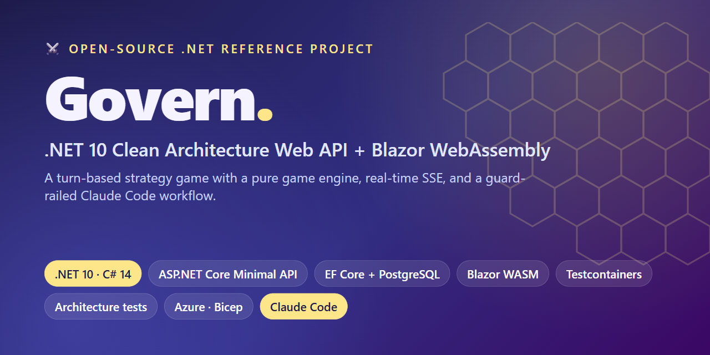
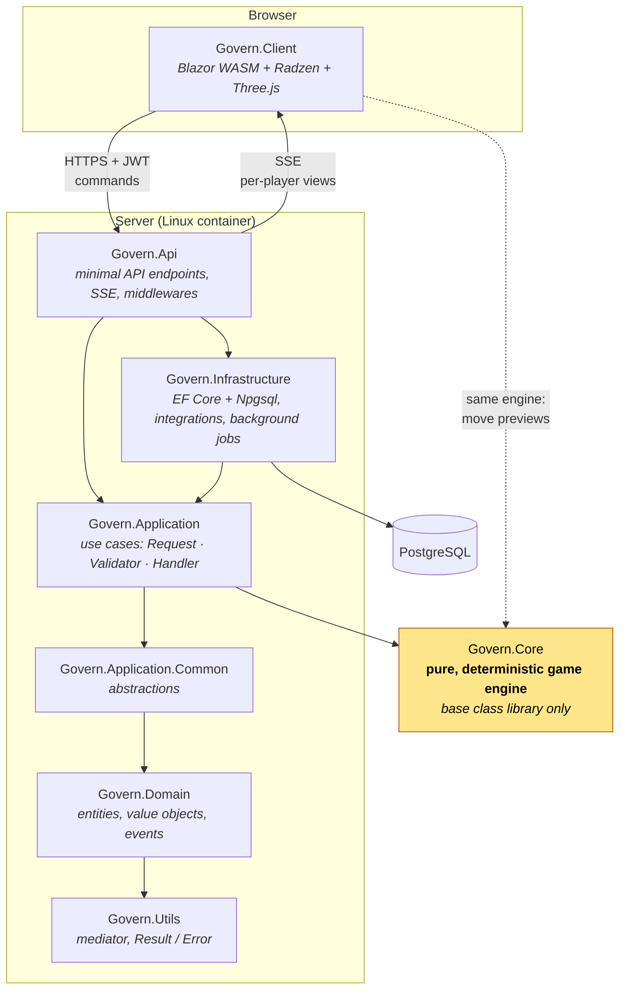
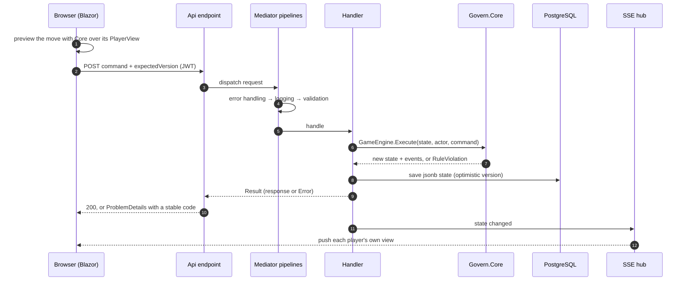
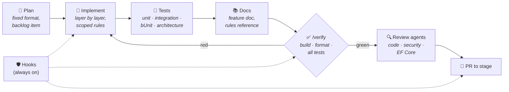

<div align="center">



# ⚔️ Govern: a .NET 10 Clean Architecture Web API + Blazor WebAssembly reference project

**A real, end-to-end .NET 10 application: an ASP.NET Core minimal API, a Blazor WebAssembly client and a turn-based strategy game, built with modern architecture, testing, DevOps and an AI-assisted Claude Code workflow.**

Hex maps with rivers and fog of war · cities, territory and a resource economy · builders, trading and a science tree · a 3D WebGL board

[](https://github.com/andy-dendy-repo/govern/actions/workflows/ci.yml)


[](LICENSE)

[Reference guide](#-use-it-as-a-reference-for) · [Tech stack](#-tech-stack-net-10-aspnet-core-ef-core-blazor) · [Architecture](#-clean-architecture-in-net-10) · [Patterns](#-patterns-and-conventions) · [Engineering](#-engineering-highlights) · [Claude Code setup](#-claude-code-setup-claudemd-hooks-skills-and-agents) · [Getting started](#-getting-started)

</div>

---

**Govern** is an open-source **.NET 10 / C# 14** reference project that shows how the pieces of a modern web application fit together in real code, not a to-do sample. It is built from:
- **ASP.NET Core minimal APIs** following **Clean Architecture**;
- **EF Core** with **PostgreSQL**;
- **JWT** authentication with rotating refresh tokens;
- live updates over **Server-Sent Events (SSE)**;
- a **Blazor WebAssembly** client with a **Three.js** 3D board.

Quality is enforced, not promised: integration tests run against real Postgres with **Testcontainers**, **architecture tests** use **ArchUnitNET**, and the build uses **Central Package Management** with warnings as errors. The API ships as a **chiseled container**, deployed to **Azure** with **Bicep** and **GitHub Actions** (OIDC). The whole codebase is developed with **Claude Code** under repo-encoded guardrails: a `CLAUDE.md`, path-scoped rules, hooks, skills and read-only review agents.

## 💡 What this project demonstrates

A solo pet project, built end to end from the domain model to the cloud:

- 🎮 **Domain modelling:** a deterministic, data-driven game engine with fog of war, an economy, trading and a science tree, kept pure and shared by server and browser.
- 🏛️ **Architecture that holds:** Clean Architecture whose rules are **executable**. Architecture tests fail the build when a layer, folder or naming convention is broken.
- 🔐 **Production practices:** JWT with rotating refresh tokens, rate limiting, CSP, ProblemDetails, health checks, live updates over SSE, and an infrastructure-as-code deployment to Azure.
- 🧪 **Testing at every level:** 1,500+ tests, from pure unit tests to HTTP + real Postgres integration tests and bUnit component tests.
- 🤖 **AI-assisted engineering done safely:** the AI pair programmer works inside repo-encoded rules, hooks and review agents ([details](#-claude-code-setup-claudemd-hooks-skills-and-agents)).

## 🧭 Use it as a reference for…

Looking for a working example of something? Start here:

| Looking for… | See |
|---|---|
| **Clean Architecture in .NET 10**, with enforced layer rules | [`src/`](src) · [architecture doc](docs/architecture.md) · [`LayerDependencyTests`](tests/Govern.ArchitectureTests/LayerDependencyTests.cs) |
| **ASP.NET Core minimal APIs**, one endpoint per file, auto-discovered | [`SignInEndpoint.cs`](src/Govern.Api/Features/Users/SignInEndpoint.cs) · [`EndpointExtensions.cs`](src/Govern.Api/Extensions/EndpointExtensions.cs) |
| **Result pattern + mediator without MediatR**, with pipelines | [`Result.cs`](src/Govern.Utils/Results/Result.cs) · [`Mediator/Pipelines`](src/Govern.Utils/Mediator/Pipelines) · [ADR 0001](docs/decisions/0001-mediator.md) |
| A use case as **Request + FluentValidation validator + handler** in one file | [`SignInContract.cs`](src/Govern.Application/Users/Contracts/SignInContract.cs) |
| **Errors as values → RFC 9457 ProblemDetails** | [`ResultExtensions.cs`](src/Govern.Api/Extensions/ResultExtensions.cs) |
| **EF Core without repositories**: `IDbContextFactory`, interceptors, domain events | [`IApplicationDbContextFactory.cs`](src/Govern.Application.Common/Abstractions/IApplicationDbContextFactory.cs) · [`Interceptors/`](src/Govern.Infrastructure/Persistence/Interceptors) |
| **Value objects** that can't be invalid | [`Email.cs`](src/Govern.Domain/ValueObjects/Email.cs) |
| **JWT + rotating refresh tokens** with reuse detection | [users feature](docs/features/users.md) · [ADR 0002](docs/decisions/0002-auth-tokens.md) |
| **Blazor WebAssembly auth**: token refresh, `AuthenticationStateProvider`, cross-tab lock | [`Client/Auth/`](src/Govern.Client/Auth) |
| **Server-Sent Events (SSE)** live updates with per-user views | [`WatchGameEndpoint.cs`](src/Govern.Api/Features/Games/WatchGameEndpoint.cs) · [ADR 0005](docs/decisions/0005-live-updates.md) |
| **Optimistic concurrency** with EF Core | [`SendGameCommandContract.cs`](src/Govern.Application/Games/Contracts/SendGameCommandContract.cs) |
| A **pure, deterministic domain engine** shared by server and client | [`GameEngine.cs`](src/Govern.Core/Engine/GameEngine.cs) · [ADR 0004](docs/decisions/0004-game-engine.md) |
| **Integration tests with Testcontainers + Respawn** and `WebApplicationFactory` | [`GovernApiFixture.cs`](tests/Govern.IntegrationTests/Fixtures/GovernApiFixture.cs) · [`GovernApiFactory.cs`](tests/Govern.IntegrationTests/Fixtures/GovernApiFactory.cs) |
| **Architecture tests** with ArchUnitNET and reflection | [`tests/Govern.ArchitectureTests`](tests/Govern.ArchitectureTests) |
| **Central Package Management** and a strict `Directory.Build.props` | [`Directory.Packages.props`](Directory.Packages.props) · [`Directory.Build.props`](Directory.Build.props) |
| A **.NET container without a Dockerfile** (chiseled, non-root) | [`Govern.Api.csproj`](src/Govern.Api/Govern.Api.csproj) |
| **Azure with Bicep** and **GitHub Actions with OIDC** | [`infra/`](infra) · [`release.yml`](.github/workflows/release.yml) · [deployment doc](docs/operations/deployment.md) |
| A real **Claude Code setup**: `CLAUDE.md`, rules, hooks, skills, agents | [`CLAUDE.md`](CLAUDE.md) · [`.claude/`](.claude) · [details below](#-claude-code-setup-claudemd-hooks-skills-and-agents) |

## 🎲 The game

Two players start on opposite edges of a hex map, which is either generated with mirrored halves or picked from a pool of hand-made maps. They found cities, grow their territory, build an economy and fight. The last player standing wins.

| | |
|---|---|
| 🗺️ **Map** | Hex tiles with plains, forest, hills, mountains, lakes and desert. Rivers run along tile edges and have crossing costs and a defence bonus. Fog of war applies from the first turn |
| 🏰 **Cities** | Production, territory that grows with culture, and each city's own stock of food, water, wood, stone, gold, science and culture, with storage caps |
| 🛠️ **Builders** | Farms, lumber camps, mines and bridges, plus city buildings (campus, harbour, market, barracks, university…) placed on territory tiles |
| ⚔️ **Combat** | 14 units, from settlers and spearmen to knights and biremes. Units have health, class counters, ranged attacks, terrain defence, healing and a combat forecast |
| 💰 **Economy** | Tile yields, resource costs, upkeep with a per-city priority, supply off territory and shortage damage |
| 🤝 **Trading** | City markets, traders with a home city, and deals that can be proposed, countered, accepted or declined |
| 🔬 **Science** | A science tree that unlocks units and buildings, with unit lines, upgrades and building upgrades |

Every number in the game lives in a versioned, validated **ruleset** ([`rulesets/default/v14.json`](rulesets/default/v14.json)), not in code. The player-facing [rules reference](docs/game/rules.md) is checked against that ruleset by tests, so it can't drift from the game.

## 🧰 Tech stack: .NET 10, ASP.NET Core, EF Core, Blazor

| Concern | Choice |
|---|---|
| **Runtime** | .NET 10 / C# 14, warnings as errors, XML docs required on every public member |
| **API** | ASP.NET Core minimal APIs, OpenAPI with Swagger UI, RFC 9457 ProblemDetails, rate limiting, health checks |
| **Live updates** | Server-Sent Events: each player gets their own snapshot whenever their view changes |
| **Database** | PostgreSQL with EF Core and Npgsql, snake_case naming, game state stored as `jsonb` |
| **Auth** | JWT bearer access tokens with rotating refresh tokens and reuse detection |
| **Validation** | FluentValidation, run by a mediator pipeline |
| **Client** | Blazor WebAssembly + Radzen, with a strict CSP and security headers |
| **3D board** | Three.js (WebGL) with low-poly terrain built in code and CC0 [KayKit](https://kaylousberg.itch.io/) unit models baked by [`tools/unit-models`](tools/unit-models) |
| **Tests** | xUnit v3 on Microsoft Testing Platform, Shouldly, Testcontainers + Respawn, bUnit, ArchUnitNET |
| **Hosting** | Azure Web App for Containers (Linux) for the API, Azure Static Web Apps for the client, Azure Database for PostgreSQL Flexible Server, Key Vault |
| **Infra and delivery** | Bicep, GitHub Actions (CI on every PR, OIDC-based release to Azure), Dependabot, Cloudflare DNS |

## 🧱 Clean Architecture in .NET 10

The server follows **Clean Architecture**: dependencies point inward, and the game rules live in a pure engine that the browser runs as well.



| Project | Responsibility | May reference |
|---|---|---|
| `Govern.Core` | Hex map, units, cities, economy, commands and rules, fog of war, JSON format | **nothing**: no projects, no packages, no `Microsoft.*` |
| `Govern.Utils` | In-house mediator, `Result<T>` and `Error` | nothing |
| `Govern.Domain` | Entities, value objects, domain events | Core, Utils |
| `Govern.Application.Common` | Abstractions Infrastructure implements (DB context factory, current user…) | Core, Domain, Utils |
| `Govern.Application` | Use cases grouped by feature | Application.Common, Core, Domain, Utils |
| `Govern.Infrastructure` | Persistence, integrations, background jobs | all of the above |
| `Govern.Api` | Composition root and HTTP surface | all server projects |
| `Govern.Client` | Browser UI | **Core only** |

### The game engine

`Govern.Core` is the heart of the project: `GameEngine.Execute(state, actor, command)` takes an immutable `GameState` and returns either a new state plus events, or a `RuleViolation`.

- **Authoritative server:** clients send intents and only the server changes stored state, so nobody can cheat from the browser.
- **Deterministic:** no clock, no I/O and no `System.Random`. A seeded SplitMix64 generator is stored in the state, so replaying a command log rebuilds the game exactly.
- **Shared with the client:** the browser runs the same rules over its `PlayerView` to preview reachable tiles, attack targets and city sites, so the logic isn't duplicated.
- **Fog of war by construction:** clients only ever receive a `PlayerView`. Events are filtered per player, and rule rejections are worded so they reveal nothing hidden.
- **Data-driven:** every stat, cost and yield comes from the ruleset, and `RulesetValidator` checks each ruleset with JSON paths in its errors.

### A command's journey



## 🧩 Patterns and conventions

- **Vertical slices in a layered shell:** one use case is one file, `Application/[Feature]/Contracts/XxxContract.cs`, holding exactly `XxxRequest`, `XxxResponse`, `XxxValidator` and `XxxHandler`. Each endpoint is one file in `Api/Features/[Feature]/XxxEndpoint.cs`.
- **In-house mediator** ([ADR 0001](docs/decisions/0001-mediator.md)): `IRequest<TRequest, TResponse>` handlers return `Result<T>`, and the pipelines run error handling → logging → validation.
- **Errors as values:** expected failures are `Error` constants per feature, mapped to ProblemDetails with a stable `code`. Only bugs throw.
- **No mapping libraries** ([ADR 0003](docs/decisions/0003-no-mapping-libraries.md)): EF `Select` projections and static `Projection` / `From` members.
- **No generic repositories:** handlers use a short-lived `DbContext` from a factory. A repository exists only when a query needs caching.
- **Domain events** are published after `SaveChanges` by EF interceptors, which also stamp audit fields.
- **Value objects** such as `Email` can't hold invalid data: `TryCreate` handles untrusted input and `Create` throws.
- **Secure by default:** a deny-by-default authorization policy, refresh-token rotation with reuse detection, per-user rate limits, sign-in throttling, host filtering, CSP, and secrets only in user-secrets and Key Vault.

## ✨ Engineering highlights

**Build and code quality**
- 📦 **Central Package Management** with **transitive pinning**: every version lives in one [`Directory.Packages.props`](Directory.Packages.props), and no csproj carries a version.
- 🧱 **One [`Directory.Build.props`](Directory.Build.props)** for the whole solution:
  - nullable reference types on, and **warnings as errors**;
  - .NET analyzers at `latest-Recommended`, with code style **enforced in the build**;
  - **XML docs required** on every public member in `src/`, and a missing doc fails the build;
  - a cyclomatic-complexity limit ([`CodeMetricsConfig.txt`](CodeMetricsConfig.txt)).
- 📌 **Pinned toolchain:** [`global.json`](global.json) pins the SDK and opts into **Microsoft Testing Platform**, and [`dotnet-tools.json`](dotnet-tools.json) holds the local tools (`dotnet-ef`, Roslyn navigator).
- 🗂️ **`.slnx`**, the new XML solution format.
- 🎨 **`.editorconfig` + `dotnet format --verify-no-changes`**, checked in CI.

**Containers and delivery**
- 🐳 **No Dockerfile:** the API image is built by the .NET SDK (`dotnet publish -t:PublishContainer`) on the **Ubuntu chiseled** base image. That image has no shell and no package manager, and runs as non-root.
- ✅ **CI on every PR:**
  1. restore → build → format check;
  2. all tests with coverage, with real Postgres in Testcontainers;
  3. a **vulnerable package scan**;
  4. a client configuration dry run;
  5. a **Bicep compile**.
- 🚀 **Release on merge to `main`:**
  1. reuses CI as a called workflow;
  2. pushes the image to GHCR;
  3. logs in to Azure with **OIDC**, so no cloud credentials are stored;
  4. deploys Bicep, then the client;
  5. finishes with a health check.
- 🔒 **Supply chain:** every GitHub Action is **pinned to a commit SHA**, workflows run with least-privilege `permissions`, and **Dependabot** sends grouped weekly updates for NuGet and Actions.

**Testing infrastructure**
- 🐘 **Real database, fast resets:** integration tests share one Postgres container per run and use **Respawn** to wipe data between tests.
- ⏱️ **Fake time:** `TimeProvider` with `FakeTimeProvider`, so the lobby cleanup job and the board animations are tested without waiting.
- 📜 **Docs that can't lie:** `RulesReferenceTests` checks the tables in the player rules doc against the ruleset.

### Rules enforced by tests

Conventions here are executable. `Govern.ArchitectureTests` fails CI when one is broken:

| Test | Checks |
|---|---|
| `ProjectReferenceTests` | the allowed-reference table above; Core and the test projects stay isolated |
| `LayerDependencyTests` | type-level dependencies (ArchUnitNET); Core uses the base class library only; `HttpClient` only in typed clients and client auth |
| `FolderStructureTests` | folder templates per project, contract file contents, one endpoint per file |
| `NamingConventionTests` | no `Helper` suffix, suffix per folder, sealed handlers, immutable value objects |
| `CodeMetricsTests` | file, member and parameter size limits, including `.razor` files |
| `ClientSecurityTests` | CSP and security headers, self-hosted assets, no raw HTML, no secrets in client config |
| `RulesReferenceTests` | the player rules doc matches the ruleset |

## 🧪 Testing: unit, integration (Testcontainers), bUnit and architecture tests

**1,500+ tests** across four projects:

| Project | What it covers |
|---|---|
| `Govern.UnitTests` | Core (the game engine), Domain and Utils: pure code, no I/O |
| `Govern.IntegrationTests` | the real API over HTTP against PostgreSQL in Testcontainers: happy paths, 400, 401/403 and domain errors |
| `Govern.ClientTests` | Blazor components and services with bUnit |
| `Govern.ArchitectureTests` | the rules above |

## 🚀 Getting started

**Prerequisites:** the .NET SDK pinned in [`global.json`](global.json), and Docker.

```bash
# 1. Local Postgres
docker run -d --name govern-postgres -e POSTGRES_PASSWORD=postgres -e POSTGRES_DB=govern -p 5432:5432 postgres:17-alpine

# 2. Secrets (user-secrets, never appsettings)
cd src/Govern.Api
dotnet user-secrets set "ConnectionStrings:Govern" "Host=localhost;Port=5432;Database=govern;Username=postgres;Password=postgres"
dotnet user-secrets set "Jwt:SigningKey" "$(openssl rand -base64 48)"
cd ../..

# 3. Run the API (https://localhost:7294, Swagger at /swagger) and the client (https://localhost:7042)
dotnet run --project src/Govern.Api
dotnet run --project src/Govern.Client
```

```bash
dotnet build Govern.slnx                         # warnings are errors
dotnet test Govern.slnx                          # all tests (needs Docker)
dotnet format Govern.slnx --verify-no-changes
```

More detail is in [local development](docs/operations/local-development.md).

## 📁 Repository layout

```text
src/          production projects (see the architecture table)
tests/        unit, integration, client (bUnit) and architecture tests
rulesets/     versioned game rulesets: rulesets/<key>/vN.json, never edited once published
maps/         the hand-made map pool
docs/         knowledge base: architecture, ADRs, features, game design, operations, plans
infra/        Bicep for Azure
tools/        offline Node tools (unit model baking)
.github/      CI and release workflows
.claude/      AI-assisted development setup: rules, skills, agents, hooks
```

## 📚 Documentation

The [`docs/`](docs/README.md) folder is the project's knowledge base:

- **[Architecture](docs/architecture.md):** layers, folder templates, naming rules
- **Decisions:** [mediator](docs/decisions/0001-mediator.md) · [auth tokens](docs/decisions/0002-auth-tokens.md) · [no mapping libraries](docs/decisions/0003-no-mapping-libraries.md) · [game engine](docs/decisions/0004-game-engine.md) · [live updates](docs/decisions/0005-live-updates.md)
- **Game:** [rules reference](docs/game/rules.md) · [game logic](docs/game/game-logic.md) · [ruleset format](docs/game/game-data.md) · [maps](docs/game/maps.md) · [design roadmap](docs/game/design-roadmap.md)
- **Features:** [game core](docs/features/game-core.md) · [games and lobby](docs/features/games.md) · [game UI](docs/features/game-ui.md) · [client](docs/features/client.md) · [users](docs/features/users.md)
- **Operations:** [configuration](docs/operations/configuration.md) · [deployment](docs/operations/deployment.md) · [branching](docs/operations/branching.md)
- **Planning:** the [backlog](docs/plans/backlog.md) and every feature's plan, active and done

## 🤖 Claude Code setup: CLAUDE.md, hooks, skills and agents

Govern is built with [Claude Code](https://claude.com/claude-code) as a pair programmer. The project's conventions, workflow and safety limits are **code in the repo** ([`.claude/`](.claude) and [`CLAUDE.md`](CLAUDE.md)), not prompts typed by hand. The AI works under the same rules as a human contributor, and the rules that matter are enforced by tooling, not left to the model's judgement.



### 🚧 Guardrails: Claude Code hooks

[Hooks](.claude/hooks) are shell scripts that Claude Code runs around every action. They are deterministic and can **block** an action outright.

| When | Hook | What it does |
|---|---|---|
| Before a shell command | [`bash-guard.sh`](.claude/hooks/bash-guard.sh) | Blocks force-pushes, `reset --hard`, `clean -f`, discarding all changes and `--no-verify`. Blocks any commit or push on `main` or `stage`, so work always goes through a feature branch and a PR. Allows `rm -rf` only on build output and temp folders |
| Before a file edit | [`protect-files.sh`](.claude/hooks/protect-files.sh) | Blocks hand edits of EF Core generated migration files and of `.env` secret files |
| After a file edit | [`format-cs.sh`](.claude/hooks/format-cs.sh), [`restore.sh`](.claude/hooks/restore.sh) | Formats the edited C# file to `.editorconfig`; restores packages when a project or `Directory.Packages.props` changes |
| After a shell command | [`mark-tests.sh`](.claude/hooks/mark-tests.sh) | Records a green, unfiltered `dotnet test` run of the whole solution |
| Before finishing | [`require-tests.sh`](.claude/hooks/require-tests.sh) | **The test gate:** the AI can't say "done" while build- or test-relevant files changed after the last green full test run |
| Session start | [`session-start.sh`](.claude/hooks/session-start.sh) | Shows the branch and the branching rules; starts Docker in cloud sessions so the integration tests can run |

On top of the hooks:
- [`settings.json`](.claude/settings.json) pre-approves only read-only or build commands (`dotnet build/test/format`, `git status/diff/log`). Anything else needs approval.
- CI repeats every check on the PR, so nothing relies on the local setup alone.

### 📏 Rules, skills and agents

- **[Rules](.claude/rules) (21):** conventions loaded only where they apply. For example, `game-core.md` loads for `src/Govern.Core/**`, and `security.md` for `src`, `infra` and `.github`. They cover architecture, C# style, error handling, logging, persistence, auth, security, the Blazor client, and each test project. **Rules and architecture tests change together**, so a convention never lives in prose alone.
- **[Skills](.claude/skills) (7):** repeatable workflows.
  - `/develop-feature` is the Definition of Done: plan → implement → tests → XML docs → docs → rules update → `/verify` → review → report.
  - `/verify` is the quality gate, ending in a PASS/FAIL report.
  - `/add-use-case`, `/add-entity`, `/add-migration` and `/add-infra-concern` are recipes taken from a real slice of the codebase.
  - `/outdated-packages` checks for package updates.
- **[Agents](.claude/agents) (3):** `code-reviewer`, `security-auditor` and `ef-core-specialist`. They are **read-only** (they can't write or edit files) and keep [project memory](.claude/agent-memory) of accepted risks and past findings, so reviews don't re-raise settled issues. A security audit is part of every release: Critical or High findings block the stage → main PR.
- **Knowledge base:** [`docs/`](docs/README.md) is written for retrieval. Every page has front matter (tags, code paths, last update), and the [backlog](docs/plans/backlog.md) is the single place where priorities live.
- **MCP tools:** Roslyn navigation and refactoring, Microsoft Learn and library docs, a local Postgres inspector, and Playwright to check UI changes in a real browser.

## 🤝 Contributing

Issues and pull requests are welcome. See [CONTRIBUTING.md](CONTRIBUTING.md) for the branch flow, the Definition of Done and the conventions. To report a vulnerability, follow [SECURITY.md](SECURITY.md) and don't open a public issue.

## 📄 License

Govern is open source under the [MIT License](LICENSE): free to use, copy, modify and learn from.

Third-party assets keep their own licenses: [Three.js](src/Govern.Client/wwwroot/lib/three/LICENSE) (MIT) and the [KayKit](https://kaylousberg.itch.io/) unit models (CC0).

If this project helped you learn something, a ⭐ helps others find it.
